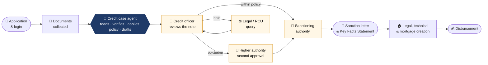
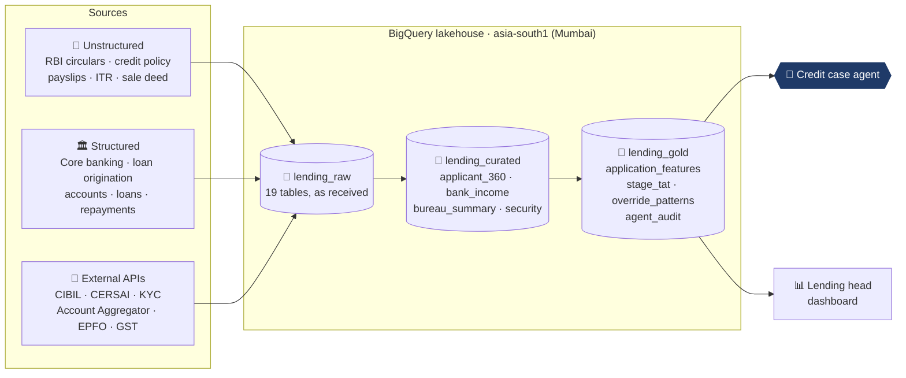
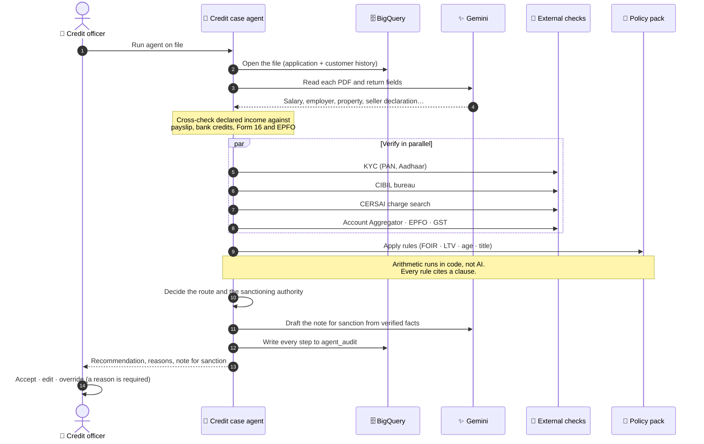
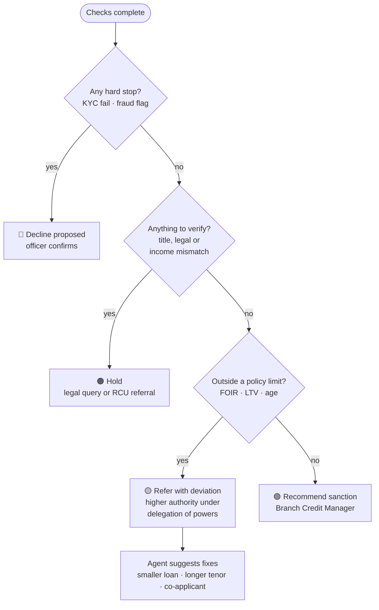
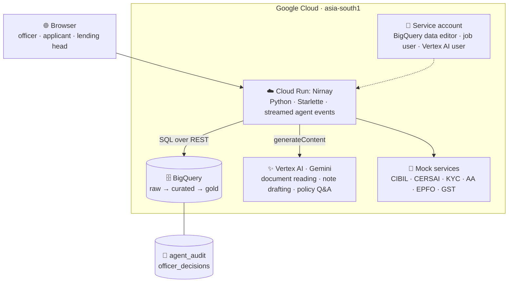

<div align="center">

# Nirnay · निर्णय

### Agentic AI for home loan approval: the agent prepares the file, the officer makes the decision.

**[▶ Open the live demo](https://nirnay-344505295928.asia-south1.run.app/)** &nbsp;·&nbsp; [Approach story](https://nirnay-344505295928.asia-south1.run.app/story) &nbsp;·&nbsp; [Architecture](https://nirnay-344505295928.asia-south1.run.app/architecture) &nbsp;·&nbsp; [Research note](web/static/docs/D5_research_note.pdf) &nbsp;·&nbsp; [AI usage log](web/static/docs/D6_ai_usage_log.pdf)


</div>

---

## The pitch in 30 seconds

A home loan in India typically takes **7–15 working days** to sanction. Most of that time isn't spent on judgement: credit officers spend it **chasing and reconciling data** from a dozen systems that don't talk to each other. Two branches can also reach different decisions on the same file, and the reasoning behind a decision is hard to audit afterwards.

**Nirnay** is a point-of-view demo for the Retail Lending head of a mid-sized Indian bank. It shows a different way of working:

- 🗄️ **One lakehouse** brings every source for a file together: documents, core banking records and external checks.
- 🤖 **One credit case agent** reads, verifies, applies policy and drafts the note for sanction. Every number shows where it came from, and every rule cites its clause.
- 👤 **People decide.** The agent recommends; officers and sanctioning authorities approve, override or escalate.

> All customers, documents and figures are **synthetic**. The bank and its credit policy are fictional, and CIBIL, CERSAI, KYC, Account Aggregator, EPFO and GST are **simulated**. The RBI rules referenced are real and linked from the policy library.

---

## 🧭 A 2-minute tour

| Step | Go to | What you'll see |
|:-:|---|---|
| 1 | [**Approach story**](https://nirnay-344505295928.asia-south1.run.app/story) | The idea in two acts: first the lakehouse, then the agent. Written for a business audience. |
| 2 | [**Officer desk**](https://nirnay-344505295928.asia-south1.run.app/demo) | Pick a demo file, click **Run agent**, and watch seven steps play out live, each with its source and policy clause. |
| 3 | Still on the desk | Read the drafted note for sanction, then accept or override it. A deviation goes to a second approver. |
| 4 | [**Lending head view**](https://nirnay-344505295928.asia-south1.run.app/head) | Turnaround by stage, how often officers override the agent, and **Policy Watch**: what the 7 Oct 2026 repo hike did to files already in progress. |
| 5 | [**Applicant view**](https://nirnay-344505295928.asia-south1.run.app/applicant) | The borrower's side: status by stage, consents given, and the Key Facts Statement. |

---

## 🗂️ Four files, four endings

Each demo file is built to show a decision that comes up in a real credit department:

| File | Applicant | What the agent finds | Outcome |
|---|---|---|---|
| `HL-2026-104401` | **Priya** | Clean file: bureau score 792 and a banking relationship going back to 2016 | 🟢 **Recommend sanction**, Branch Credit Manager |
| `HL-2026-104402` | **Arjun** | The repo hike raises his EMI, pushing FOIR to **55.5%** against a 55% cap | 🟡 **Refer with deviation** to the Regional Credit Head, with three ways to bring the file back within policy |
| `HL-2026-104403` | **Sunita** | The seller says the property has no loan on it, but **CERSAI shows a mortgage still registered** | 🟠 **Hold: legal query**, with steps to obtain the NOC, title deeds and CERSAI satisfaction |
| `HL-2026-104404` | **Vikram** | The payslip says **₹1.35 lakh a month**; bank credits, Form 16 and EPFO show about **₹88,400** | 🔴 **Hold: refer to the Risk Containment Unit (RCU)**. A verification check, not a finding of fraud. |

The other **596 synthetic applications** fill the queue, the dashboards and Policy Watch.

---

## 🏦 Where the agent sits in the real process

Home loan approval is a relay between many people and systems. Nirnay takes over the **gathering, checking and drafting** in the middle of it, and leaves every decision with a person.



<sub>Navy: the agent's work. Amber: human checkpoints. Documentation, mortgage creation and disbursement are shown as stages in the demo but not automated.</sub>

---

## Act 1 · The lakehouse: one file, one place

Data for a single home loan lives in at least nine places. The lakehouse brings it together in three layers, so the agent works from a single trusted view instead of nine partial ones.



| Layer | Dataset | What's in it |
|---|---|---|
| 🥉 Raw | `lending_raw` | 19 tables as they arrive: applications, documents, stage history, customers, accounts, loans, repayments, monthly transactions, bureau, CERSAI, KYC, Account Aggregator, EPFO, GST, valuation and legal reports, rate card, past officer decisions |
| 🥈 Curated | `lending_curated` | Cleaned and joined, one row per entity: `bank_income`, `bureau_summary`, `repayment_track`, `security`, `applicant_360` |
| 🥇 Decision-ready | `lending_gold` | `application_features` (FOIR, LTV and screening result per file), `stage_tat`, `override_patterns`, plus the `agent_audit` and `officer_decisions` logs |

**Volumes:** 600 applications · 765 customers · 7,212 monthly transaction rows · 2,124 repayments · 4,999 document records · 2,691 stage events · 435 past officer decisions.

---

## Act 2 · The agent: one agent done well

The brief says *one well-designed agent is better than many shallow ones*. Nirnay has **one credit case agent with four skills** (documents, verification, policy and credit). It runs the same seven steps on every file, which is where the consistency comes from.



### How a recommendation is routed

Banks rarely reject a file outright for breaking one rule. The agent routes each file the way a credit department would:



### Policy Watch: when the rules change

When the RBI raised the repo rate on **7 October 2026**, every floating-rate EMI went up. The agent re-checks all **127 files in progress** against the new rate in under a second. It flags the **15 files, worth ₹9.49 crore**, that have moved outside policy and would otherwise have been found one at a time. Each flag goes to the credit officer for that file; nothing is changed automatically.

---

## 🛡️ Built-in governance

| Principle | How the demo shows it |
|---|---|
| **The officer decides** | The agent never changes a file's status; overrides need a reason and are logged |
| **Every figure has a source** | Each number links to its query, API response or document |
| **Every rule has a clause** | Each check cites the bank's policy (e.g. `HLP-4.1`) or an RBI rule |
| **AI reads and writes; code calculates** | FOIR, LTV, EMI and routing are calculated in code; Gemini only reads documents and drafts the note |
| **Policy is data** | A rule change reaches files already in progress, and a new product means a new policy pack, not a rebuild |
| **Full audit trail** | Every agent step goes to `lending_gold.agent_audit`, and every decision to `officer_decisions` |

---

## ✅ Deliverables checklist

| # | Deliverable | Where |
|:-:|---|---|
| D1 | Loan approval demo (officer, applicant, lending head) | [`/demo`](https://nirnay-344505295928.asia-south1.run.app/demo) · [`/applicant`](https://nirnay-344505295928.asia-south1.run.app/applicant) · [`/head`](https://nirnay-344505295928.asia-south1.run.app/head) |
| D2 | Approach story (lakehouse, then agent) | [`/story`](https://nirnay-344505295928.asia-south1.run.app/story) |
| D3 | Architecture (business and technical) | [`/architecture`](https://nirnay-344505295928.asia-south1.run.app/architecture) |
| D4 | Supporting pages | [`/about`](https://nirnay-344505295928.asia-south1.run.app/about) · [`/faq`](https://nirnay-344505295928.asia-south1.run.app/faq) · [`/contact`](https://nirnay-344505295928.asia-south1.run.app/contact) · [`/policy`](https://nirnay-344505295928.asia-south1.run.app/policy) |
| D5 | Research note | [`/research`](https://nirnay-344505295928.asia-south1.run.app/research) · [PDF](web/static/docs/D5_research_note.pdf) |
| D6 | AI usage log | [`/ai-log`](https://nirnay-344505295928.asia-south1.run.app/ai-log) · [PDF](web/static/docs/D6_ai_usage_log.pdf) |
| ⭐ | **Bonus:** live on BigQuery data, built with Claude Code | [Live link](https://nirnay-344505295928.asia-south1.run.app/); [`/api/meta`](https://nirnay-344505295928.asia-south1.run.app/api/meta) shows the data engine and model in use |

---

## ⚙️ Technical architecture



---

## 📁 Repository layout

```
app/              Python backend
├── main.py         HTTP API and page routing
├── agent.py        the credit case agent: seven steps, streamed events
├── policy_pack.py  policy clauses, parameters and EMI/FOIR/LTV maths
├── store.py        BigQuery when deployed, SQLite stand-in when offline
├── gcp.py          REST clients for BigQuery and Gemini on Vertex AI
├── mocks.py        simulated external services
└── lakehouse.py    builds and tests the same SQL locally
web/              pages, CSS, JS, applicant PDFs, policy, D5 and D6
world/            mock responses for CIBIL, CERSAI, KYC, AA, EPFO, GST
sql/              10_curated.sql · 20_gold.sql
data/             seeded synthetic data generator + generated CSVs
deploy/           deploy.sh (one command) + BigQuery schemas
docs/             builds the D5 and D6 PDFs
Dockerfile        container for Cloud Run
```

---

## 🚀 Run it yourself

<details>
<summary><b>Option A: locally, offline (no cloud account needed)</b></summary>

Uses a SQLite stand-in for BigQuery and pre-extracted document values instead of Gemini. Every page and all four demo files still work.

```bash
pip install -r requirements.txt
python app/main.py
# open http://localhost:8080
```
</details>

<details>
<summary><b>Option B: deploy to your own Google Cloud project (about 10 minutes)</b></summary>

You need the Google Cloud SDK (`gcloud`, `bq`), Python 3 and a project with billing enabled.

```bash
gcloud auth login
bash deploy/deploy.sh YOUR_PROJECT_ID
```

The script:
1. enables the APIs
2. creates the three BigQuery datasets in Mumbai
3. loads the synthetic data
4. builds the curated and decision-ready layers
5. creates a service account with least-privilege roles
6. finds a Gemini model the project can use and deploys to Cloud Run

It prints the live URL at the end.

To run locally against your deployed BigQuery and Gemini:
```bash
GCP_PROJECT=YOUR_PROJECT_ID python app/main.py
```
</details>

---

## 🤝 Built with Claude

The research, synthetic data, SQL, agent, interface, copy and PDFs were produced with **Claude working as an agent (Claude Code)**. The candidate set the direction, made the judgement calls and checked the work. Details, including what was corrected along the way (a misattributed RBI citation, a join that produced 606 rows for 600 applications, an unrealistic share of files outside policy), are in the [AI usage log](web/static/docs/D6_ai_usage_log.pdf) and on the [how this was built](https://nirnay-344505295928.asia-south1.run.app/ai-log) page.

## 🔭 What I would build next

- **Real sandboxes** for the mock services: CIBIL, a CERSAI search, and Account Aggregator through a licensed FIU.
- **A second product as a policy pack**, such as personal loans: new rules, not a rebuild.
- **Sign-in with role-based access** for officers, sanctioning authorities and the lending head.
- **A back-test** comparing the agent's recommendations with 12 months of past officer decisions before any pilot.
